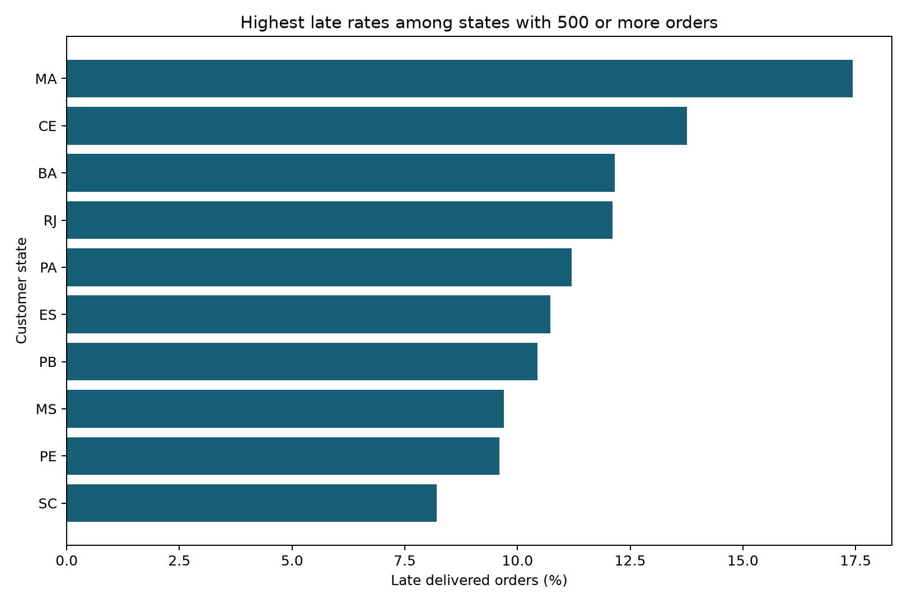
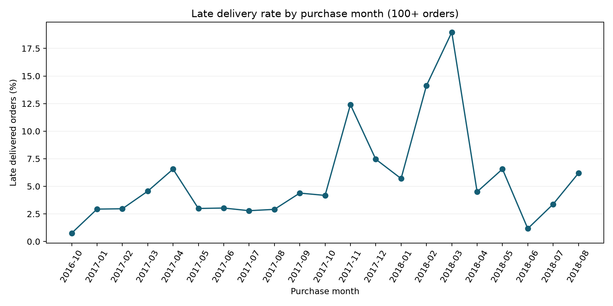

# Delivery Performance Analysis

## 1. Problem and intended reader

This project investigates how often completed deliveries missed their estimated dates and which patterns an operations manager could investigate first. It is an independent public-data portfolio exercise, not work commissioned by Olist.

## 2. Data source and scope

Source: [Brazilian E-Commerce Public Dataset by Olist](https://www.kaggle.com/datasets/olistbr/brazilian-ecommerce).

- Owner: olistbr
- Historical period: 2016–2018
- Download date and license: see [DATA_SOURCE.md](DATA_SOURCE.md).
- Inputs: olist_orders_dataset.csv and olist_customers_dataset.csv.
- Original orders: 99,441.

One analysis row represents one order. Customer records supply destination state through customer_id. Raw CSV files remain unchanged.

See [DATA_DICTIONARY.md](DATA_DICTIONARY.md) for field meanings.

## 3. Metric definitions

Eligible orders have delivered status, usable purchase, actual delivery and estimated delivery dates, and valid chronology. Actual receipt cannot precede purchase. The estimated calendar date cannot precede the purchase calendar date.

An order is late when its actual delivery calendar date is after its estimated calendar date. Arrival on the promised day counts as on time, even if the recorded estimate is midnight.

Late rate = late eligible orders / all eligible delivered orders × 100.

Delivery duration is elapsed time from purchase to receipt, in days. The median describes the middle duration. The 90th percentile describes the duration within which approximately 90% of eligible orders arrived.

Undelivered orders are excluded because completed delivery duration and final arrival lateness cannot be calculated without actual receipt dates.

## 4. Method and validation

I used Python, pandas and matplotlib to inspect inputs, validate keys, parse dates, join customer states, apply eligibility rules and summarize results.

Multiple matching customer rows could duplicate an order during a join. Key checks and join validation prevent this.

Validation included:

- Reconciliation of eligible and excluded orders to raw orders.
- Two passing automated tests covering calendar-date lateness, exclusions and duplicate customer rejection.
- Three individual date comparisons checked with AI assistance.
- A second analysis run with unchanged summary metrics.
- A state-ranking comparison at 500 and 1,000 eligible orders.

See [DECISIONS.md](DECISIONS.md) for the checks and reasoning.

## 5. Findings

### Overall performance

Of 96,470 eligible delivered orders, 6,534 were late: 6.77%. Exclusions totaled 2,971: 2,963 were not delivered and eight lacked required dates.

Median duration was 10.22 days, compared with 23.10 days at the 90th percentile. Both figures help describe the slower deliveries hidden by a single typical value.

Source: [Summary metrics](outputs/metrics.json).

### State differences

Among states with at least 500 eligible orders, MA had the highest late rate: 125 of 717, or 17.43%. RJ had 1,495 late orders out of 12,350, or 12.11%. Both rate and affected order count matter.

Source: [State results](outputs/state_delivery.csv).



### Monthly differences

Among purchase months with at least 100 eligible orders, March 2018 had the highest late rate: 1,328 of 7,003, or 18.96%. February 2018 recorded 14.13% (926 of 6,555), compared with 4.50% in April 2018 (306 of 6,798).

Source: [Monthly results](outputs/monthly_delivery.csv).



### Independent improvement

I compared state rankings using minimum volumes of 500 and 1,000 orders. At 1,000, MA no longer qualified and CE ranked highest: 176 late orders out of 1,279, or 13.76%.

Individual rates were unchanged. The threshold changes which states qualify. The original chart retains the 500-order threshold.

Source: [Threshold comparison](outputs/state_threshold_comparison.csv).

## 6. Recommendations and limitations

Investigate February–March 2018 purchase cohorts and the state patterns using carrier, route, seller-origin, service-type and promised-lead-time information.

A high state late rate does not establish a cause. The core analysis does not isolate those operational factors.

Results describe eligible delivered orders, not all promised deliveries. Excluding unresolved deliveries creates a selection limitation. Boundary months may represent incomplete observation windows.

Minimum-volume thresholds are screening rules, not statistical significance tests. Historical results do not establish current performance.

See [FINDINGS.md](FINDINGS.md) for the report.

## 7. Reproduction

Use Windows PowerShell and Python 3.13. Run commands from the project folder.

Create the environment and install recorded package versions:

```powershell
py -3.13 -m venv .venv
.\.venv\Scripts\python.exe -m pip install -r requirements-lock.txt
New-Item -ItemType Directory -Force data\raw, outputs
```

Download the dataset from the source link. Place olist_orders_dataset.csv and olist_customers_dataset.csv directly inside data/raw.

Run:

```powershell
.\.venv\Scripts\python.exe inspect_data.py
.\.venv\Scripts\python.exe analyse.py
.\.venv\Scripts\python.exe -m unittest -v test_analyse.py
.\.venv\Scripts\python.exe compare_thresholds.py
```

Exact package versions are in requirements-lock.txt. Reproduction requires obtaining source data separately. The lock file records packages but does not guarantee identical behavior on every operating system.

## 8. Project files

data/raw/ - Unedited source files; excluded from publication 
inspect_data.py - Inspect inputs, missing values and keys 
analyse.py - Validate data, calculate metrics and generate outputs 
test_analyse.py - Automated behaviour checks 
compare_thresholds.py - Compare state volume thresholds 
outputs/ - Generated tables, metrics and charts 
requirements.txt - Package version bounds 
requirements-lock.txt - Installed package versions 
DATA_SOURCE.md - Source, licence and download details 
DATA_DICTIONARY.md - Fields and metric rules 
DECISIONS.md - Decisions and validation 
FINDINGS.md - Findings and recommendations 


